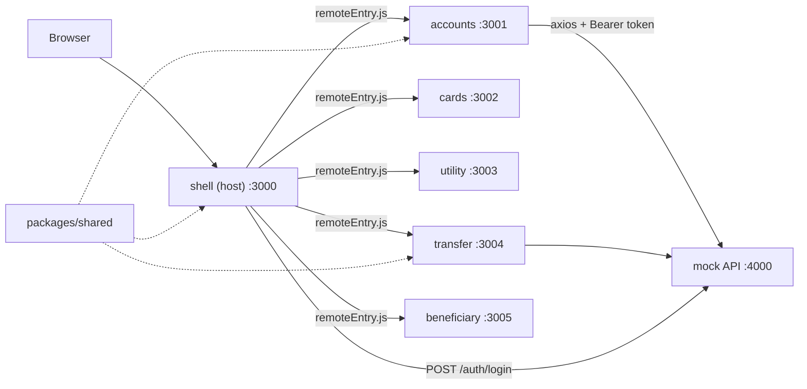

# Retail Internet Banking - Micro-Frontend Demo

A small sample built with **Vite + React + TypeScript + Bootstrap** that demonstrates:

1. **Micro-frontend architecture** with Module Federation: a host (shell) app loads 5 independently built remote apps at runtime.
2. **A clean API layer** with axios: one shared client, interceptors, a service layer per module and reusable hooks.
3. **Route guarding**: authentication guard, permission guard, guest-only route, and automatic logout on 401.

## Architecture



```text
sample-mfe-route-authguard/
├── mock-api/                 json-server backend: login, token check, permissions, delay
├── packages/shared/          used by the host and every remote
│   └── src/
│       ├── api/httpClient.ts     axios instance + interceptors
│       ├── api/ApiError.ts       normalized error type
│       ├── auth/authStore.ts     session in sessionStorage, hasPermission()
│       ├── hooks/useApi.ts       GET on mount: data / loading / error / refetch + cancellation
│       ├── hooks/useMutation.ts  POST / PATCH / DELETE: mutate / loading / error
│       ├── types/banking.ts     API models (Account, Card, Transfer, ...) shared by all apps
│       └── components/           Loader, ErrorAlert, StandaloneShell
└── apps/
    ├── shell/                HOST: login, layout, routing, guards, dashboard
    ├── accounts/             REMOTE: account list, statement (GET + query params)
    ├── cards/                REMOTE: card list, block / unblock (PATCH)
    ├── utility/              REMOTE: billers, pay bill (POST)
    ├── transfer/             REMOTE: fund transfer form + receipt (POST, validation)
    └── beneficiary/          REMOTE: list, add, delete (POST, DELETE)
```

- Each remote exposes a single `./App` with its own internal `<Routes>`. The shell mounts it under `/accounts/*`, `/cards/*` and so on, so remotes only use relative paths and never know where they are mounted.
- `react`, `react-dom` and `react-router-dom` are shared as singletons, so all remotes use the host's router.
- Modules talk to each other only through URLs (for example, Beneficiary links to `/transfer?beneficiaryId=1`). They never import each other.
- Auth state is kept in a framework-agnostic store (`sessionStorage`) instead of a React context, so it works across separately built bundles.

### TypeScript setup

- All apps extend [tsconfig.base.json](tsconfig.base.json) (`strict` mode). `npm run build` runs `tsc` before `vite build`, so a type error fails the build.
- API models live in [packages/shared/src/types/banking.ts](packages/shared/src/types/banking.ts) and act as the contract between the backend and every micro-frontend. Services are typed end to end, for example `httpClient.get<Account[]>('/accounts')`, so `useApi` infers `data` as `Account[] | null` without extra annotations.
- Federated imports such as `import('accounts/App')` only exist at runtime, so the shell declares them in [apps/shell/src/remotes.d.ts](apps/shell/src/remotes.d.ts).
- The mock API in `mock-api/` stays plain JavaScript; it is a stand-in backend, not part of the frontend.

## Getting started

Requires Node 18 or later.

```bash
npm install
npm run dev
```

Open http://localhost:3000.

| Script | What it does |
| --- | --- |
| `npm run dev` (or `dev:all`) | Mock API, all remotes (build in watch mode + preview) and the shell in Vite dev mode |
| `npm run preview:all` | Production build of everything, served with `vite preview` |
| `npm run build` | Type-check and build all remotes and the shell |
| `npm run typecheck` | Run `tsc` on every workspace |
| `npm run api` | Mock API only |

Remotes are built and served with `vite preview` even in development, because `@originjs/vite-plugin-federation` only generates `remoteEntry.js` at build time. When you edit a remote, the watch build picks up the change; refresh the browser to see it.

Each remote can also be opened on its own port (for example http://localhost:3001). It shows a "Dev login" button so a team can work on its module without the shell.

### Demo users

| User | Password | Permissions |
| --- | --- | --- |
| `john` | `1234` | accounts, cards, utility, transfer, beneficiary |
| `viewer` | `1234` | accounts, cards, utility |

### Mock API settings

The API keeps data in memory and resets on restart. You can change its behaviour with environment variables:

- `API_DELAY_MS` (default `600`): artificial latency so loading states are visible
- `TOKEN_TTL_MS` (default 15 minutes): token lifetime

For example, `TOKEN_TTL_MS=30000 npm run api` makes the session expire after 30 seconds.

## How API calls are structured

```text
Page component  ->  useApi / useMutation  ->  moduleService  ->  httpClient (axios)  ->  API
```

| Layer | Responsibility | Example |
| --- | --- | --- |
| `httpClient` | Base URL, timeout, auth header, correlation id, error normalization, 401 handling | [packages/shared/src/api/httpClient.ts](packages/shared/src/api/httpClient.ts) |
| Service | One function per endpoint, returns plain data, no React | [apps/accounts/src/services/accountService.ts](apps/accounts/src/services/accountService.ts) |
| Hook | Loading / error / data state, request cancellation | [packages/shared/src/hooks/useApi.ts](packages/shared/src/hooks/useApi.ts) |
| Component | Renders state, never calls axios directly | [apps/accounts/src/pages/AccountList.tsx](apps/accounts/src/pages/AccountList.tsx) |

Things to point out in the code:

- **Request interceptor** adds `Authorization: Bearer <token>` and an `X-Correlation-Id` header to every call.
- **Response interceptor** turns every failure (timeout, network down, 4xx/5xx) into an `ApiError { status, message }`, so components show `error.message` without any parsing. On a 401 it clears the session and fires an `auth:logout` event, which the shell listens for.
- **Cancellation**: `useApi` passes an `AbortSignal`, so leaving a page or changing the `:accountId` param cancels the in-flight request.
- **Parallel calls**: the dashboard and the transfer form use `Promise.all` to load independent data together.
- **Query params**: `accountService.getTransactions` passes `params` instead of building the URL by hand.
- **Server-side validation**: the API rejects a transfer that exceeds the balance (422), and the message is shown as-is.

## How route guarding works

```jsx
<Route element={<GuestRoute />}>          {/* logged-in users skip /login */}
  <Route path="/login" element={<Login />} />
</Route>
<Route element={<ProtectedRoute />}>      {/* must be logged in */}
  <Route element={<MainLayout />}>
    <Route element={<PermissionRoute permission="transfer" />}>   {/* must have permission */}
      <Route path="transfer/*" element={<RemoteBoundary><TransferApp /></RemoteBoundary>} />
    </Route>
  </Route>
</Route>
```

There are three layers, and each one is demoable on its own:

1. **Menu hiding**: the sidebar only shows modules the user is allowed to use. This is convenience, not security.
2. **Route guards**: typing `/transfer` directly as `viewer` still shows a 403 page.
3. **API enforcement**: the mock API checks the same permissions and returns 403, so a bypassed UI still cannot get data.

Also note that the remote code for a module the user cannot access is never downloaded, because the guard renders before the lazy import.

## Demo script

1. Open http://localhost:3000/accounts while logged out. You are redirected to login with "Please sign in to access /accounts".
2. Sign in as `john`. You land back on `/accounts`, which is the `from` redirect. In DevTools > Network, `remoteEntry.js` is loaded from port 3001 only now.
3. Open a statement. Two requests run, and both carry the `Authorization` and `X-Correlation-Id` headers.
4. Block a card (PATCH), pay a bill (POST), add a beneficiary (client-side validation, then POST).
5. On Beneficiaries, click **Send money**. This is cross-MFE navigation by URL, and the beneficiary is pre-selected in the transfer form.
6. Try transferring more than the balance of an account (above 200000 is blocked client-side; between the balance and the limit, the server returns 422).
7. On the Dashboard, click **Simulate session expiry (401)**. The interceptor logs you out with "Your session has expired".
8. Sign in as `viewer`. Transfer and Beneficiaries disappear from the menu, and visiting `/transfer` directly shows 403.
9. Stop the cards remote (or run everything except it) and open Cards. Only that module shows "temporarily unavailable"; the rest of the app keeps working.
