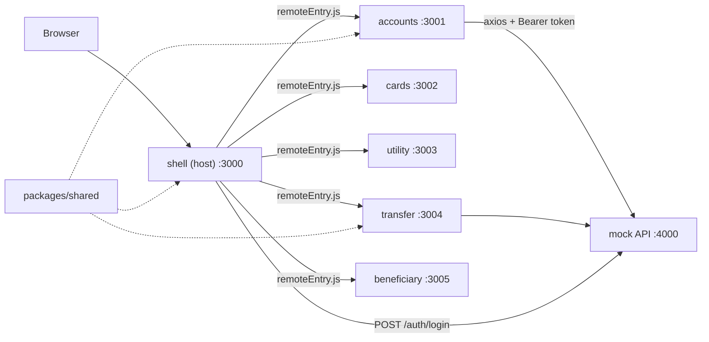
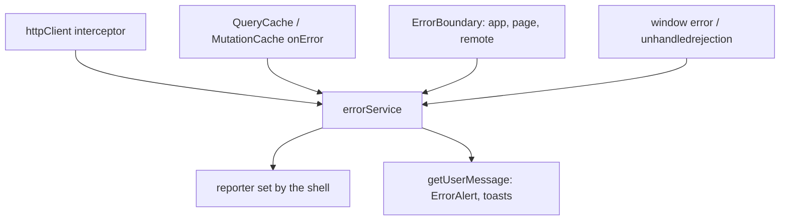

# Retail Internet Banking - Micro-Frontend Demo

A small sample built with **Vite + React + TypeScript + Bootstrap** that demonstrates:

1. **Micro-frontend architecture** with Module Federation: a host (shell) app loads 5 independently built remote apps at runtime.
2. **A clean API layer** with axios: one shared client, interceptors, a service layer per module and reusable hooks.
3. **Route guarding**: authentication guard, permission guard, guest-only route, and automatic logout on 401.

## Architecture



```text
sample-mfe-route-authguard/
├── mock-api/                 json-server backend: login, token check, permissions, delay
├── packages/shared/          used by the host and every remote
│   └── src/
│       ├── api/httpClient.ts     axios instance + interceptors
│       ├── api/ApiError.ts       normalized error type (status, kind, correlation id)
│       ├── errors/errorService.ts reportError(), setErrorReporter(), getUserMessage()
│       ├── auth/authStore.ts     session store (Zustand, sessionStorage), useSession(), useHasPermission()
│       ├── query/                QueryClient defaults, shared query keys, queries used by several MFEs
│       ├── store/                createGlobalStore(): one store instance across all bundles
│       ├── ui/uiStore.ts         shared UI state: toasts (notify()), sidebar collapsed
│       ├── types/banking.ts     API models (Account, Card, Transfer, ...) shared by all apps
│       └── components/           Loader, ErrorAlert, ErrorBoundary, Toaster, StandaloneShell
└── apps/
    ├── shell/                HOST: login, layout, routing, guards, dashboard
    ├── accounts/             REMOTE: account list, statement (GET + query params)
    ├── cards/                REMOTE: card list, block / unblock (PATCH)
    ├── utility/              REMOTE: billers, pay bill (POST)
    ├── transfer/             REMOTE: fund transfer form + receipt (POST, validation)
    └── beneficiary/          REMOTE: list, add, delete (POST, DELETE)
```

- Each remote exposes a single `./App` with its own internal `<Routes>`. The shell mounts it under `/accounts/*`, `/cards/*` and so on, so remotes only use relative paths and never know where they are mounted.
- `react`, `react-dom`, `react-router-dom` and `@tanstack/react-query` are shared as singletons, so all remotes use the host's router and the host's query cache.
- Modules talk to each other only through URLs (for example, Beneficiary links to `/transfer?beneficiaryId=1`) and shared state (see [State management](#state-management)). They never import each other.

### TypeScript setup

- All apps extend [tsconfig.base.json](tsconfig.base.json) (`strict` mode). `npm run build` runs `tsc` before `vite build`, so a type error fails the build.
- API models live in [packages/shared/src/types/banking.ts](packages/shared/src/types/banking.ts) and act as the contract between the backend and every micro-frontend. Services are typed end to end, for example `httpClient.get<Account[]>('/accounts')`, so `useQuery(accountsQuery())` infers `data` as `Account[] | undefined` without extra annotations. `ApiError` is registered as TanStack Query's default error type, so `query.error` is always an `ApiError`.
- Federated imports such as `import('accounts/App')` only exist at runtime, so the shell declares them in [apps/shell/src/remotes.d.ts](apps/shell/src/remotes.d.ts).
- The mock API in `mock-api/` stays plain JavaScript; it is a stand-in backend, not part of the frontend.

## Getting started

Requires Node 18 or later.

```bash
npm install
npm run dev
```

Open http://localhost:3000.

| Script | What it does |
| --- | --- |
| `npm run dev` (or `dev:all`) | Mock API, all remotes (build in watch mode + preview) and the shell in Vite dev mode |
| `npm run preview:all` | Production build of everything, served with `vite preview` |
| `npm run build` | Type-check and build all remotes and the shell |
| `npm run typecheck` | Run `tsc` on every workspace |
| `npm run api` | Mock API only |

Remotes are built and served with `vite preview` even in development, because `@originjs/vite-plugin-federation` only generates `remoteEntry.js` at build time. When you edit a remote, the watch build picks up the change; refresh the browser to see it.

Each remote can also be opened on its own port (for example http://localhost:3001). It shows a "Dev login" button so a team can work on its module without the shell.

### Demo users

| User | Password | Permissions |
| --- | --- | --- |
| `john` | `1234` | accounts, cards, utility, transfer, beneficiary |
| `viewer` | `1234` | accounts, cards, utility |

### Mock API settings

The API keeps data in memory and resets on restart. You can change its behaviour with environment variables:

- `API_DELAY_MS` (default `600`): artificial latency so loading states are visible
- `TOKEN_TTL_MS` (default 15 minutes): token lifetime

For example, `TOKEN_TTL_MS=30000 npm run api` makes the session expire after 30 seconds.

## How API calls are structured

```text
Page component  ->  useQuery / useMutation  ->  query options / service  ->  httpClient (axios)  ->  API
```

| Layer | Responsibility | Example |
| --- | --- | --- |
| `httpClient` | Base URL, timeout, auth header, correlation id, error normalization, 401 handling | [packages/shared/src/api/httpClient.ts](packages/shared/src/api/httpClient.ts) |
| Query options / service | `queryOptions` (key + fetch function) for reads, one function per endpoint for writes, no React | [apps/cards/src/services/cardService.ts](apps/cards/src/services/cardService.ts) |
| TanStack Query | Caching, loading / error state, retries, cancellation, invalidation | [packages/shared/src/query/queryClient.ts](packages/shared/src/query/queryClient.ts) |
| Component | Renders state, never calls axios directly | [apps/accounts/src/pages/AccountList.tsx](apps/accounts/src/pages/AccountList.tsx) |

Things to point out in the code:

- **Request interceptor** adds `Authorization: Bearer <token>` and an `X-Correlation-Id` header to every call.
- **Response interceptor** turns every failure (timeout, network down, 4xx/5xx) into an `ApiError { status, kind, message, correlationId }`. On a 401 it clears the session and fires an `auth:logout` event, which the shell listens for. See [Error handling](#error-handling) for the rest.
- **Cancellation**: every `queryFn` forwards TanStack Query's `AbortSignal` to axios, so a request whose result is no longer needed is cancelled.
- **Parallel calls**: the dashboard and the transfer form run independent queries side by side.
- **Query params**: `transactionsQuery` passes `params` instead of building the URL by hand.
- **Server-side validation**: the API rejects a transfer that exceeds the balance (422), and the message is shown as-is.

## Error handling

The host owns error handling. Remotes only render `ErrorAlert` for their own queries and mutations; everything else (logging, reporting, session handling, crash recovery) happens centrally.



**API errors.** The interceptor in [httpClient.ts](packages/shared/src/api/httpClient.ts) gives every `ApiError` a `kind`:

| Kind | Cause | What happens |
| --- | --- | --- |
| `unauthorized` | 401 | Session cleared, `auth:logout` fired once, cache cleared, redirect to login |
| `forbidden` | 403 | `auth:forbidden` fired; the shell shows a "permissions may have changed" toast |
| `notFound`, `validation` | 404, other 4xx | Server message shown inline (it is written for users) |
| `server`, `timeout`, `network` | 5xx, timeout, no response | Reported; generic message shown with a short reference ID; queries retry up to 2 times |

Only a 401 for a request sent with the *current* token ends the session, so parallel 401s log out once and a late 401 from an old session cannot log out a new one.

**Runtime errors.** [ErrorBoundary](packages/shared/src/components/ErrorBoundary.tsx) is used at three levels: around the whole shell (full-page fallback instead of a white screen), around the routed page in `MainLayout` (navbar and menu keep working), and around each remote in `RemoteBoundary`. It tells a failed download of a remote ("temporarily unavailable", Reload) apart from a render crash ("Something went wrong", Try again). Page and remote boundaries reset when the URL changes. Errors outside rendering are caught by `window` `error` and `unhandledrejection` listeners in the shell's `main.tsx`.

**Common service.** [errorService.ts](packages/shared/src/errors/errorService.ts) provides:

- `reportError(error, { source, module })`: sends each error to the reporter once (the same error object, or the same error within 3 seconds, is ignored).
- `setErrorReporter(fn)`: the shell installs one reporter for every bundle. Replace its body with Sentry, Datadog, or a logging endpoint.
- `getUserMessage(error)` and `getErrorReference(error)`: the only place that decides what a user sees. 5xx and transport details never reach the UI.

Like the stores, the service lives on `globalThis`, because each remote bundles its own copy of `@bank/shared`. For the same reason, use `isApiError()` instead of `instanceof ApiError`.

Expected outcomes (401, 4xx validation) are not reported. A failed background refetch, where old data stays on screen, shows a toast.

**Trying each case**

- 401: Dashboard, **Simulate session expiry (401)**.
- 403 from the API: sign in as `viewer`, add `"transfer"` to `user.permissions` in the `rib.session` entry in DevTools > Application > Session Storage, reload, and open Transfer.
- Network error: stop the mock API and click Retry on any page, or refocus the window on a page with data to see the refetch toast.
- Remote unavailable: stop one remote and open its route.
- Render crash: add `throw new Error('boom')` to a remote page, open it, then navigate away. The rest of the shell keeps working and the console shows the report with the module name.

## State management

Each kind of state has one home:

| Kind | Examples | Where it lives |
| --- | --- | --- |
| Server state | accounts, transactions, cards, billers, beneficiaries | TanStack Query cache, owned by the shell |
| Session state | token, user, permissions | Zustand `authStore`, persisted to `sessionStorage` |
| Shared UI state | toasts, sidebar collapsed | Zustand `uiStore` (sidebar persisted to `localStorage`) |
| Local UI / form state | form fields, validation errors, bill receipt | `useState` in the component |
| URL state | `:accountId`, `?beneficiaryId=`, transfer receipt | React Router params, search params, `location.state` |

Rules:

- Data that the API owns is server state. Read it with `useQuery` and change it with `useMutation`. Never copy it into `useState` or a store.
- State that several MFEs need, or that must outlive a route, goes in a Zustand store.
- Anything else stays local. If it should survive a refresh or be shareable as a link, put it in the URL.

### Server state across micro-frontends

- The shell creates the only `QueryClient` ([apps/shell/src/main.tsx](apps/shell/src/main.tsx)). `@tanstack/react-query` is a federation singleton, so `useQuery` inside a remote reads the shell's cache. In standalone mode, `StandaloneShell` provides its own client.
- Cache keys come from one factory, [packages/shared/src/query/queryKeys.ts](packages/shared/src/query/queryKeys.ts). Queries that several MFEs read (`accountsQuery`, `beneficiariesQuery`) live in `@bank/shared`, so the dashboard, accounts, transfer and utility modules all share one `/accounts` cache entry.
- Mutations keep the cache correct:
  - Transfer and bill payment invalidate `accounts` and `transactions`, so balances update everywhere.
  - Card block and unblock write the PATCH response straight into the cache.
  - Deleting a beneficiary is optimistic: the row disappears immediately and comes back if the call fails.
- Defaults: data is fresh for 30 seconds. Only network errors and 5xx are retried, up to 2 times; mutations never retry.
- Logout, and the forced logout on a 401, call `queryClient.clear()`, so the next user never sees cached data from the previous one.
- In dev, the React Query Devtools button (bottom left) shows the live cache.

### Client state across micro-frontends

`@bank/shared` is bundled into each remote separately, so a store created at module level would exist once per bundle. [createGlobalStore](packages/shared/src/store/createGlobalStore.ts) keeps each store on `globalThis`. The first bundle to load creates the store, and every later bundle reuses it.

- `authStore` keeps its imperative API (`getToken()`, `hasPermission()`) for the axios interceptor, and adds the reactive hooks `useSession()` and `useHasPermission()` for components.
- `notify(message, type)` can be called from any remote, and the toast shows up in the shell's `<Toaster />`.

## How route guarding works

```jsx
<Route element={<GuestRoute />}>          {/* logged-in users skip /login */}
  <Route path="/login" element={<Login />} />
</Route>
<Route element={<ProtectedRoute />}>      {/* must be logged in */}
  <Route element={<MainLayout />}>
    <Route element={<PermissionRoute permission="transfer" />}>   {/* must have permission */}
      <Route path="transfer/*" element={<RemoteBoundary><TransferApp /></RemoteBoundary>} />
    </Route>
  </Route>
</Route>
```

There are three layers, and each one is demoable on its own:

1. **Menu hiding**: the sidebar only shows modules the user is allowed to use. This is convenience, not security.
2. **Route guards**: typing `/transfer` directly as `viewer` still shows a 403 page.
3. **API enforcement**: the mock API checks the same permissions and returns 403, so a bypassed UI still cannot get data.

Also note that the remote code for a module the user cannot access is never downloaded, because the guard renders before the lazy import.

## Demo script

1. Open http://localhost:3000/accounts while logged out. You are redirected to login with "Please sign in to access /accounts".
2. Sign in as `john`. You land back on `/accounts`, which is the `from` redirect. In DevTools > Network, `remoteEntry.js` is loaded from port 3001 only now.
3. Open a statement. Two requests run, and both carry the `Authorization` and `X-Correlation-Id` headers.
4. Block a card (PATCH), pay a bill (POST), add a beneficiary (client-side validation, then POST).
5. On Beneficiaries, click **Send money**. This is cross-MFE navigation by URL, and the beneficiary is pre-selected in the transfer form.
6. Try transferring more than the balance of an account (above 200000 is blocked client-side; between the balance and the limit, the server returns 422).
7. On the Dashboard, click **Simulate session expiry (401)**. The interceptor logs you out with "Your session has expired".
8. Sign in as `viewer`. Transfer and Beneficiaries disappear from the menu, and visiting `/transfer` directly shows 403.
9. State management: go Dashboard -> Accounts -> Dashboard. The second visit renders instantly from the cache. Make a transfer, then open Accounts: the new balance is there because the transfer invalidated `accounts`. Each write also shows a toast that the remote raised and the shell rendered.
10. Stop the cards remote (or run everything except it) and open Cards. Only that module shows "temporarily unavailable"; the rest of the app keeps working.
